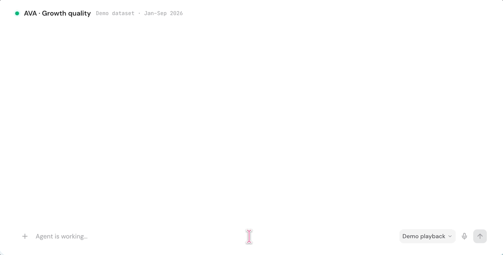

<div align="center">
  <h1>AVA, AI-native Visual Analytics</h1>
  
</div>

AVA is an open-source TypeScript library for analyzing data with natural-language questions. Load a file or connect a database, ask a question, and get computed results, a summary, and optional charts.

Use the SDK in your application, the CLI in your terminal, or the AVA skill with an AI coding agent. AVA uses a language model to generate queries and an execution engine to calculate the answers.

<p align="center">
  <a href="https://github.com/antvis/ava">
    
  </a>
  <a href="https://ava.antv.vision">
    
  </a>
  <a href="https://ava.antv.vision/documentation/">
    
  </a>
  <a href="https://ava.antv.vision/ai/">
    
  </a>
  <a href="https://ava.antv.vision/llms.txt">
    
  </a>
  <a href="https://sive.antv.antgroup.com/" title="A data analysis app built with AVA">
    
  </a>
</p>

<p align="center">
  
</p>

## Features

- **Analyze data:** ask questions, execute generated queries, and summarize the results.
- **Create charts:** recommend a chart type and generate chart specifications or HTML.
- **Understand a dataset:** inspect tables and columns, compute statistics, and suggest questions.
- **Add business rules:** define what measures such as revenue mean for your data.
- **Choose an engine:** use DuckDB, JavaScript, Python/pandas, Supabase, or ClickHouse.

## Quickstart

Use Node.js **22.13 or later**. In your project directory:

```bash
npm install @antv/ava@4

export OPENAI_API_KEY='<your-api-key>'
export OPENAI_MODEL='gpt-4o-mini'
# For another OpenAI-compatible provider, set its model name and API URL:
# export OPENAI_BASE_URL='https://your-provider.example/v1'
```

Save the following as `analysis.mjs`. It uses the default DuckDB engine:

```javascript
import { writeFile } from 'node:fs/promises';
import { AVA } from '@antv/ava';

const ava = new AVA({
  llm: {
    model: process.env.OPENAI_MODEL || 'gpt-4o-mini',
    apiKey: process.env.OPENAI_API_KEY,
    baseURL: process.env.OPENAI_BASE_URL,
  },
});

try {
  await ava.source({
    type: 'json',
    options: {
      data: [
        { region: 'East', revenue: 120 },
        { region: 'West', revenue: 90 },
        { region: 'East', revenue: 80 },
      ],
    },
  });

  const result = await ava.analyze('Show total revenue by region as a column chart');
  console.log(result.text);
  console.table(result.data);

  const chart = await ava.visualize(result);
  if (chart) {
    await writeFile('revenue.html', chart.html);
    console.log('Saved revenue.html');
  }
} finally {
  await ava.dispose();
}
```

Run `node analysis.mjs`. The result should show **East: 200** and **West: 90**; wording and column names can vary. Open `revenue.html` in a browser with internet access to view the chart. `visualize()` returns `null` when no chart is recommended.

For a walkthrough, see the [quickstart](https://ava.antv.vision/documentation/quickstart/). For frontend applications, use `@antv/ava/browser` with the [JavaScript engine](https://ava.antv.vision/documentation/browser/).

## Connect your data

<table width="100%">
  <tr>
    <td align="center" width="25%"><a href="https://ava.antv.vision/documentation/data/sources/#csv"><br />CSV</a></td>
    <td align="center" width="25%"><a href="https://ava.antv.vision/documentation/data/sources/#json"><br />JSON</a></td>
    <td align="center" width="25%"><a href="https://ava.antv.vision/documentation/data/sources/#parquet"><br />Parquet</a></td>
    <td align="center" width="25%"><a href="https://ava.antv.vision/documentation/data/sources/#excel"><br />Excel</a></td>
  </tr>
  <tr>
    <td align="center"><a href="https://ava.antv.vision/documentation/data/sources/#sqlite"><br />SQLite</a></td>
    <td align="center"><a href="https://ava.antv.vision/documentation/data/sources/#mysql"><br />MySQL</a></td>
    <td align="center"><a href="https://ava.antv.vision/documentation/data/sources/#postgresql"><br />PostgreSQL</a></td>
    <td align="center"><a href="https://ava.antv.vision/documentation/data/sources/#mongodb"><br />MongoDB</a></td>
  </tr>
  <tr>
    <td align="center"><a href="https://ava.antv.vision/documentation/data/sources/#clickhouse"><br />ClickHouse</a></td>
    <td align="center"><a href="https://ava.antv.vision/documentation/data/sources/#supabase"><br />Supabase</a></td>
    <td align="center"><a href="https://ava.antv.vision/documentation/data/sources/#text"><br />Text (LLM)</a></td>
    <td align="center"><a href="https://ava.antv.vision/documentation/data/sources/#feishu-bitable">Feishu Bitable / Lark</a></td>
  </tr>
</table>

For example, load a CSV file instead of the inline rows above:

```javascript
await ava.source({ type: 'csv-file', options: { path: './sales.csv' } });
```

See [data sources](https://ava.antv.vision/documentation/data/sources/) for connection settings and [execution engines](https://ava.antv.vision/documentation/engines/overview/) for source support. Applications can also [register a custom engine](https://ava.antv.vision/documentation/engines/custom/).

## Use with an AI agent

The agent plans the analysis and writes queries; AVA loads data, executes queries, and renders charts. This workflow uses the agent's existing model and does not require a separate AVA model API key.

On macOS or Linux, install the CLI and skill:

```bash
npm install -g @antv/ava@4
npx --yes skills add antvis/AVA --skill ava --yes
```

Start a new agent session, then ask:

```text
Use the AVA skill to analyze ./sales.csv. Compare January and February 2025
sales, identify the products contributing most to the change, and save a chart.
```

Use your own file or download the [sample sales.csv](__tests__/datasets/sales.csv). See the [Agent Skill guide](https://ava.antv.vision/documentation/agent-skill/) for setup and a complete example.

## Use from the CLI

The CLI requires macOS or Linux. To ask natural-language questions, set the model variables shown in the quickstart **before** loading a source:

```bash
ava source ./sales.csv
```

Use the dataset ID returned by `source`:

```bash
ava analyze '<your-dataset-id>' 'Compare January and February 2025 sales by product, including the change.'
ava dispose '<your-dataset-id>'
```

`analyze` returns JSON. `dispose` releases the dataset session. See the [CLI reference](https://ava.antv.vision/documentation/reference/cli/) for direct queries, charts, and other commands.

## Documentation

- [Introduction](https://ava.antv.vision/documentation/) — choose how to use AVA.
- [Analyze data](https://ava.antv.vision/documentation/analysis/overview/) — results, suggestions, and query execution.
- [Define data semantics](https://ava.antv.vision/documentation/data/semantic/) — business rules and reusable measures.
- [Generate visualizations](https://ava.antv.vision/documentation/visualization/overview/) — chart specifications and rendering.
- [API reference](https://ava.antv.vision/documentation/reference/api/) — signatures, parameters, and return values.
- [Benchmarks](https://ava.antv.vision/documentation/reference/benchmarks/) — evaluation results and reproduction.
- [llms.txt](https://ava.antv.vision/llms.txt) — documentation index for AI tools.

## Contributing

Contributions are welcome. Include tests and documentation for new features, and use [Issues](https://github.com/antvis/AVA/issues) for bug reports and feature requests.

```bash
npm install
npm run build
npm test
```

For model-backed tests, copy `.env.example` to `.env` and add your model settings. See [site/README.md](site/README.md) for the website and documentation workflow.

## 🔗 Related Projects

- [GPT-Vis](https://github.com/antvis/GPT-Vis) - Visualization components
- [Chart Visualization Skills](https://github.com/antvis/chart-visualization-skills) - LLM skills for charts
- [Vercel AI SDK](https://sdk.vercel.ai/) - LLM integration

## License

[MIT](LICENSE)
