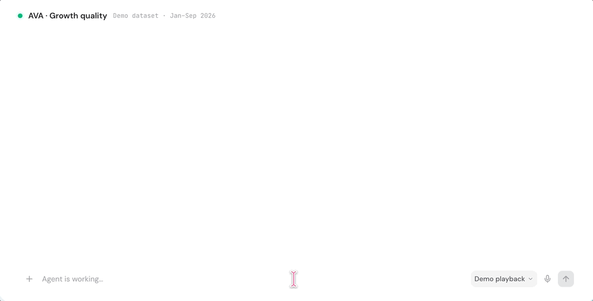
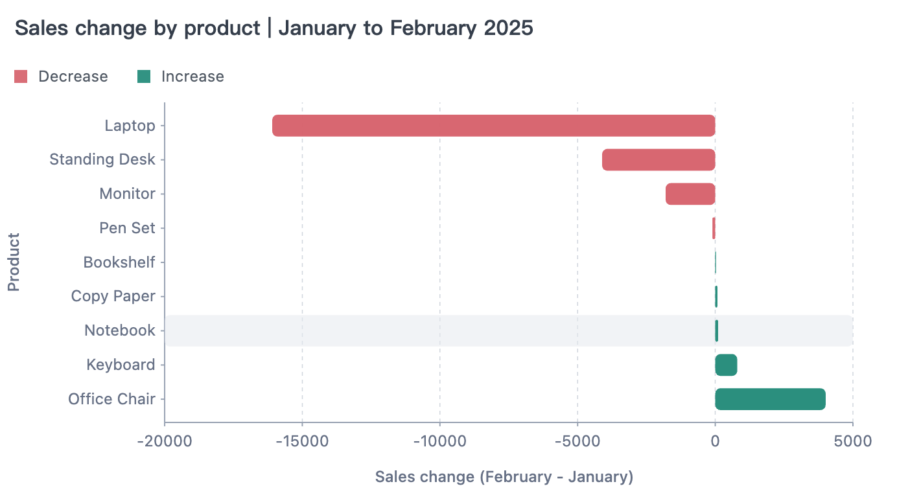

<div align="center">
  <h1>AVA, AI-native Visual Analytics</h1>
  
</div>

[AVA](https://github.com/antvis/AVA) ( Visual Analytics) is a technology framework designed for more convenient visual analytics. The first **A** has multiple meanings: AI native, Automated, Augmented, and **VA** stands for Visual Analytics. It can assist users in unstructured data loading, data processing and analysis, as well as visualization code generation.

<p align="center">
  <a href="https://github.com/antvis/ava">
    
  </a>
  <a href="https://ava.antv.vision">
    
  </a>
  <a href="https://ava.antv.vision/documentation/">
    
  </a>
  <a href="https://ava.antv.vision/ai/">
    
  </a>
  <a href="https://ava.antv.vision/llms.txt">
    
  </a>
  <a href="https://sive.antv.antgroup.com/" title="A data analysis app built with AVA">
    
  </a>
</p>

<p align="center">
  
</p>

## ✨ Features

- 💬 **[Natural-language analysis](https://ava.antv.vision/documentation/analysis/overview/)** — Turn questions into executable queries, computed results, and summaries.
- 📊 **[Visualization](https://ava.antv.vision/documentation/visualization/overview/)** — Recommend chart types and generate chart specifications and HTML.
- 🔍 **[Data profiling](https://ava.antv.vision/documentation/data/schema/#profile-a-dataset)** — Inspect tables and calculate missing-value counts, ranges, and averages.
- 💡 **[Question suggestions](https://ava.antv.vision/documentation/analysis/overview/#suggest-questions)** — Discover useful questions based on your data's structure and available statistics.
- 🔌 **[App and agent integration](https://ava.antv.vision/documentation/agent-skill/)** — Use AVA through its SDK, CLI, or agent skill.
- ⚙️ **[Multiple execution engines](https://ava.antv.vision/documentation/engines/overview/)** — Use DuckDB, Python/pandas, or remote databases in Node.js, and JavaScript in browsers.
- 🧩 **[Composable workflows](https://ava.antv.vision/documentation/analysis/overview/#translate-and-execute-separately)** — Combine data loading, query generation, direct queries, and chart rendering.

## 🚀 Getting started

### 📦 Installation

Install the v4 beta with Node.js 22.13+:

```bash
npm install @antv/ava@beta
```

### 💻 Usage

Investigate a monthly sales decline: measure the change, identify the largest contributors, and visualize the breakdown.

#### Load data

Download [sales.csv](__tests__/datasets/sales.csv) to your working directory. The sample contains 240 orders across 2025, with products, regions, channels, sales, and profit.

```typescript
import { AVA } from '@antv/ava';

const ava = new AVA({
  llm: {
    model: '<your-model>',
    apiKey: '<your-api-key>',
    // baseURL: '<your-provider-api-url>',
  },
});

await ava.source({ type: 'csv-file', options: { path: './sales.csv' } });
```

#### Ask questions

Measure the overall change using `sales`, the amount after discounts:

```typescript
const overview = await ava.analyze(`
  Compare total sales in January and February 2025 using the sales column.
  Include the change and percentage change.
`);
console.log(overview.text);
```

Expected: sales fell from **38,897.18 to 21,804.11**, down **17,093.07 (43.94%)**.

Find the products contributing to the decline:

```typescript
const result = await ava.analyze(`
  Compare January and February 2025 sales by product using the sales column.
  Show both months and the change, ordered by the largest decline.
`);
console.log(result.text);
console.table(result.data);
```

Expected breakdown:

| Product | January sales | February sales | Change |
| --- | ---: | ---: | ---: |
| Laptop | 19,688.10 | 3,596.00 | −16,092.10 |
| Standing Desk | 9,655.80 | 5,546.10 | −4,109.70 |
| Monitor | 6,536.25 | 4,731.00 | −1,805.25 |
| Pen Set | 232.20 | 127.71 | −104.49 |
| Bookshelf | 1,225.50 | 1,251.30 | +25.80 |
| Copy Paper | 59.19 | 137.06 | +77.87 |
| Notebook | 31.50 | 137.03 | +105.53 |
| Keyboard | 215.64 | 1,015.31 | +799.67 |
| Office Chair | 1,253.00 | 5,262.60 | +4,009.60 |

Laptops contributed the largest decline, while office chairs delivered the largest increase.

`analyze()` includes known token usage in `result.usage`. To aggregate usage across a workflow, pass the same
`RunContext` to its AVA calls:

```typescript
import { createRunContext } from '@antv/ava';

const run = createRunContext();
await ava.source({ type: 'csv-file', options: { path: './sales.csv' } }, {}, run);
const result = await ava.analyze('Compare sales by product.', {}, run);

console.log(result.usage); // usage for this analysis
console.log(run.usage.getUsage()); // usage across the workflow
console.log(run.usage.hasUnknownUsage); // true if a model call did not report usage
```

<!-- Image placeholder: monthly sales comparison, 43.94% decline, and product contribution table. -->

#### Visualize charts

Chart each product's contribution to the sales change:

```typescript
import { writeFile } from 'node:fs/promises';

const chart = await ava.visualize({
  query: 'Plot the sales change by product from January to February 2025 as a bar chart.',
  data: result.data,
});
if (chart) {
  await writeFile('sales-change.html', chart.html);
}
```

Open `sales-change.html` in a browser with internet access.



#### Find questions to explore

Get suggested questions for your data:

```typescript
const suggestions = await ava.suggest();
console.log(suggestions);
```

> 💡 **Suggested questions**
>
> How do sales change month by month?
>
> Which products contribute the most profit?
>
> How do sales compare across channels?

#### Understand your data

Check missing values and sales ranges:

```typescript
console.log(await ava.schema());
console.log(await ava.profile({ metrics: ['row_count', 'null_count', 'min', 'max'] }));
```

The sample has one missing `region` and one missing `quantity`.

Release resources when finished:

```typescript
await ava.dispose();
```

## 🔌 Connect your data

Connect files and databases, or load inline data.

<table width="100%">
  <tr>
    <td align="center" width="25%"><a href="https://ava.antv.vision/documentation/data/sources/#csv"><br />CSV</a></td>
    <td align="center" width="25%"><a href="https://ava.antv.vision/documentation/data/sources/#json"><br />JSON</a></td>
    <td align="center" width="25%"><a href="https://ava.antv.vision/documentation/data/sources/#parquet"><br />Parquet</a></td>
    <td align="center" width="25%"><a href="https://ava.antv.vision/documentation/data/sources/#excel"><br />Excel</a></td>
  </tr>
  <tr>
    <td align="center"><a href="https://ava.antv.vision/documentation/data/sources/#sqlite"><br />SQLite</a></td>
    <td align="center"><a href="https://ava.antv.vision/documentation/data/sources/#mysql"><br />MySQL</a></td>
    <td align="center"><a href="https://ava.antv.vision/documentation/data/sources/#postgresql"><br />PostgreSQL</a></td>
    <td align="center"><a href="https://ava.antv.vision/documentation/data/sources/#mongodb"><br />MongoDB</a></td>
  </tr>
  <tr>
    <td align="center"><a href="https://ava.antv.vision/documentation/data/sources/#clickhouse"><br />ClickHouse</a></td>
    <td align="center"><a href="https://ava.antv.vision/documentation/data/sources/#supabase"><br />Supabase</a></td>
    <td align="center"><a href="https://ava.antv.vision/documentation/data/sources/#text"><br />Text (LLM)</a></td>
    <td align="center"><a href="https://ava.antv.vision/documentation/engines/custom/"><br />Custom engine</a></td>
  </tr>
</table>

Load an Excel workbook with `source()`:

```typescript
await ava.source({ type: 'excel', options: { path: './sales.xlsx' } });
```

See the [data source guide](https://ava.antv.vision/documentation/data/sources/) for connection settings and engine support.

For browser applications, use `@antv/ava/browser` with inline data. See [runtime configuration](https://ava.antv.vision/documentation/browser/).

## 🧩 More ways to use AVA

The agent and CLI workflows run on Node.js 22.13+ on macOS or Linux.

### Use with an Agent

Your agent plans the analysis; AVA runs queries and creates charts.

```bash
npm install -g @antv/ava@beta
npx skills add antvis/AVA
```

In a new agent session, ask:

```text
Use the AVA skill to analyze ./sales.csv. Compare January and February 2025
sales, identify the products contributing most to the change, and save a chart.
```

This workflow uses your agent's existing model. See [agent setup](https://ava.antv.vision/documentation/agent-skill/).

### Use from the CLI

Configure your model and load a CSV:

```bash
npm install -g @antv/ava@beta

export OPENAI_API_KEY='<your-api-key>'
export OPENAI_MODEL='<your-model>'
# export OPENAI_BASE_URL='<your-provider-api-url>'

ava source ./sales.csv
```

Use the dataset ID returned by `source`:

```bash
ava analyze '<your-dataset-id>' 'Compare January and February 2025 sales by product, including the change.'
ava dispose '<your-dataset-id>'
```

`analyze` returns the answer as JSON. `dispose` releases the dataset. See [all CLI commands](https://ava.antv.vision/documentation/reference/cli/).

## 📚 Resources

- [Documentation](https://ava.antv.vision/documentation/) — Guides and examples
- [Analysis strategies](https://ava.antv.vision/documentation/analysis/strategies/) — Direct, loop, and subset execution
- [API Reference](https://ava.antv.vision/documentation/reference/api/) — Methods and configuration
- [AI](https://ava.antv.vision/ai/) — Try out AVA in the browser environment
- [Benchmarks](https://ava.antv.vision/documentation/reference/benchmarks/) — Evaluation results
- [Issues](https://github.com/antvis/AVA/issues) — Bug reports and feature requests

## 🤝 Developer Contributions

Contributions are welcome. Include tests, examples, and documentation with new features.

Run `npm test` to test your changes. For model-backed tests, copy `.env.example` to `.env` and add your model settings.

## 🔗 Related Projects

- [GPT-Vis](https://github.com/antvis/GPT-Vis) - Visualization components
- [Chart Visualization Skills](https://github.com/antvis/chart-visualization-skills) - LLM skills for charts
- [Vercel AI SDK](https://sdk.vercel.ai/) - LLM integration

## 📑 Papers

[VizLinter](https://vegalite-linter.idvxlab.com/) - Chen, Q., Sun, F., Xu, X., Chen, Z., Wang, J. and Cao, N., 2021. VizLinter: A Linter and Fixer Framework for Data Visualization. *IEEE transactions on visualization and computer graphics*, 28(1), pp.206-216.

[《数据可视化设计的类型学实践》（Exploring the Typology of Visualization Design）](https://oversea.cnki.net/KCMS/detail/detail.aspx?dbcode=CJFD&dbname=CJFDAUTO&filename=MSDG202203021&uniplatform=OVERSEAS_EN&v=HcZsiecIxauSoKEB1s92_BImgnrMiazYsfZUpb-gcl0zXYx_MEwv5alz1UgtPjz1) - 蓝星宇, 王嘉喆. 数据可视化设计的类型学实践, 《美术大观》, 2022(3), 149-152.

## ⚖️ License

MIT
