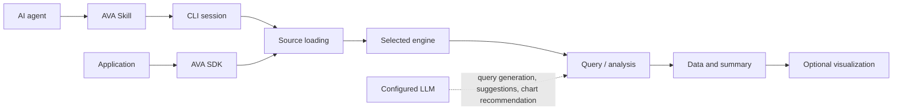

# AVA

**AI-native visual analytics for agents and applications.** Connect structured data, inspect and query it, and turn results into charts—with an Agent Skill, CLI, or TypeScript SDK.

AVA is an open-source framework for giving AI agents and developers a practical way to work with data. Use its built-in data access and execution paths, or embed its analysis capabilities in your application.

> **Project status:** AVA 4 is currently published as an alpha release.

[Getting started](#quick-start) · [Examples](#build-with-the-sdk) · [Documentation](https://ava.antv.vision/)

<p align="center">
  
</p>

## What AVA Does

- **Connect and inspect:** Load supported files, inline data, or databases; inspect schemas and profiles.
- **Query and analyze:** Run SQL, Python, or JavaScript in the selected engine, or ask a natural-language question with a configured LLM.
- **Visualize results:** Recommend a chart and generate GPT-Vis syntax or standalone HTML from analysis results.
- **Meet your workflow:** Use AVA through an Agent Skill, the CLI, or a composable TypeScript SDK.

## Connect Your Data

| Data | Supported sources | Node.js / CLI | Browser |
| --- | --- | --- | --- |
| Files |  CSV ·  JSON · Parquet ·  Excel · SQLite files | Yes | No |
| Databases |  MySQL ·  PostgreSQL ·  SQLite ·  MongoDB* | Yes | No |
| Remote query |  ClickHouse ·  Supabase | Yes | No |
| Inline data | CSV · JSON · text | Yes | Yes |

*MongoDB uses DuckDB's community extension and infers collection schemas from sampled documents. Browser builds support inline CSV, JSON, and text only. Text extraction uses an LLM. See [data source and engine details](skills/ava/references/sources.md).

## Quick Start

Install AVA and run a local query over inline data. This example uses no database or LLM request:

```bash
npm install @antv/ava
```

```typescript
import { AVA } from '@antv/ava';

const ava = new AVA({ llm: { model: 'gpt-4o-mini' } });

try {
  await ava.source({
    type: 'json',
    options: {
      data: [
        { region: 'East', revenue: 120 },
        { region: 'West', revenue: 80 },
        { region: 'East', revenue: 30 },
      ],
    },
  });

  const result = await ava.query(
    'SELECT region, SUM(revenue) AS total FROM data GROUP BY region ORDER BY total DESC'
  );
  console.log(result.data);
  // [{ region: 'East', total: 150 }, { region: 'West', total: 80 }]
} finally {
  await ava.dispose();
}
```

`llm.model` is required by the SDK configuration; direct queries and profiling do not call the model. Natural-language analysis, suggestions, and chart recommendations do. See the [Getting Started guide](skills/ava/references/setup.md).

## Use AVA with an AI Agent

Add the AVA Skill to an agent that supports Agent Skills. The agent interprets the request and plans the analysis; AVA's CLI accesses the data, executes queries, and renders charts. The agent uses its own reasoning, so this flow does not require a separate AVA model API key.

```bash
npm install -g @antv/ava
npx skills add antvis/AVA
```

Then ask your agent:

```text
Use the AVA skill to analyze /absolute/path/sales.csv,
compare sales by region, and generate a chart.
```

The CLI requires Node.js 22.13+ on macOS or Linux. See the [AVA Skill](skills/ava/SKILL.md), [CLI setup](skills/ava/references/setup.md), and [CLI commands](src/cli/index.ts). The Skill also has a [Claude Code marketplace entry](.claude-plugin/marketplace.json).

## Build with the SDK

Embed AVA in a Node.js application to load a source, ask a natural-language question, and optionally generate a chart:

```typescript
import { AVA } from '@antv/ava';

const ava = new AVA({
  llm: {
    model: 'gpt-4o-mini',
    apiKey: process.env.OPENAI_API_KEY!,
  },
});

try {
  await ava.source({
    type: 'json',
    options: { data: [{ city: 'Hangzhou', gdp: 18753 }, { city: 'Shanghai', gdp: 43214 }] },
  });

  const profile = await ava.profile();
  console.log(profile.tables[0].metrics);

  const result = await ava.analyze('Compare GDP by city');
  console.log(result.text, result.data);

  const chart = await ava.visualize(result);
  if (chart) console.log(chart.chartType, chart.html);
} finally {
  await ava.dispose();
}
```

For browser applications, import from `@antv/ava/browser`; that build uses the JavaScript engine and accepts inline CSV, JSON, or text. See the [public AVA API](src/ava.ts), [SDK types](src/types.ts), and [visualization guide](skills/ava/references/visualization.md).

## Customize AVA

Choose a built-in engine and tune its supported options—for example, DuckDB resource limits or query timeouts. The Python engine also accepts a custom `execute` function, allowing an application to provide its own Python execution environment. Its callback receives the complete script and must return an `ExecutionResult`; AVA does not provide a generic public registry for custom engines, tools, or data sources.

```typescript
const ava = new AVA({
  llm: { model: 'gpt-4o-mini', apiKey: process.env.OPENAI_API_KEY! },
  engine: { type: 'duckdb', threads: 2, queryTimeoutMs: 10_000 },
});
```

Python's default local execution is not a security sandbox. Review the [engine configuration and interfaces](src/types.ts) before supplying a custom executor.

## How AVA Fits Together

The Agent or application owns the user interaction. The Skill guides an agent to use the CLI; an application can call the SDK directly. AVA loads a source into the selected engine, which provides schema and executes queries. Natural-language analysis uses an LLM to generate executable queries; visualization can then turn result data into a chart.



Node.js registers DuckDB, Python, JavaScript, ClickHouse, and Supabase engines; the browser entry registers only JavaScript. Sources, engines, and analysis strategies are defined by public types and implementations—see the [engine registry](src/engines.ts) and [analysis strategies](src/analysis/).

## Documentation & Community

- [Getting started](#quick-start)
- [Agent Skill](skills/ava/SKILL.md) · [CLI setup](skills/ava/references/setup.md)
- [Data sources](skills/ava/references/sources.md) · [Queries and results](skills/ava/references/queries.md)
- [Visualization](skills/ava/references/visualization.md) · [SDK API](src/ava.ts)
- [DataBench evaluation and methodology](evals/ACCURACY.md)
- [Report an issue or propose a change](https://github.com/antvis/AVA/issues)
- [MIT License](LICENSE)
