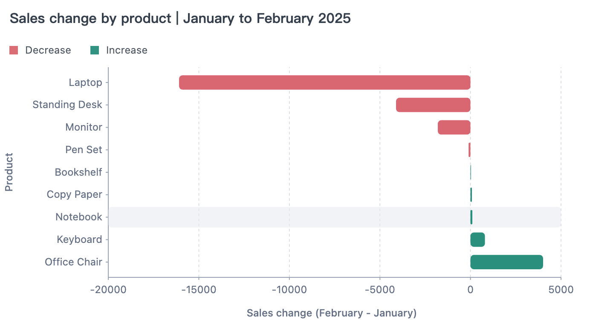

[English](./README.md) | **简体中文**

<div align="center">
  <h1>AVA，AI 原生数据分析与可视化框架</h1>
  
</div>

<p align="center">
  <a href="https://ava.antv.vision/zh/">
    
  </a>
  <a href="https://ava.antv.vision/zh/documentation/">
    
  </a>
  <a href="https://ava.antv.vision/zh/ai/">
    
  </a>
  <a href="https://sive.antv.antgroup.com/" title="基于 AVA 构建的数据分析应用">
    
  </a>
  <a href="https://github.com/antvis/ava">
    
  </a>
  <a href="https://ava.antv.vision/llms.txt">
    
  </a>
</p>

[AVA](https://github.com/antvis/AVA)（ Visual Analytics）是一个面向应用和 AI 智能体的数据分析与可视化框架。**A** 代表 AI 原生（AI-native）、自动化（Automated）和增强（Augmented）；**VA** 代表数据分析与可视化（Visual Analytics）。

<p align="center">
  
</p>

> [!NOTE]
> **可以把 AVA 理解为 JavaScript 生态中的 PandasAI。💬📊🤖**
>
> 它让应用和 AI 智能体能够通过自然语言完成数据分析与可视化。

## ✨ 为什么选择 AVA？

<table width="100%">
  <tr>
    <td width="33%" valign="top">
      <h3>🔌 统一数据接入</h3>
      <p>通过同一套接口连接<strong>文件和数据库</strong>。</p>
      <a href="https://ava.antv.vision/zh/documentation/data/sources/">数据源 →</a>
    </td>
    <td width="33%" valign="top">
      <h3>🔎 有据可查的分析</h3>
      <p>查看每个回答背后的<strong>查询语句和执行结果</strong>。</p>
      <a href="https://ava.antv.vision/zh/documentation/analysis/overview/">可信分析 →</a>
    </td>
    <td width="33%" valign="top">
      <h3>📊 智能可视化</h3>
      <p>根据<strong>问题和数据</strong>生成合适的图表。</p>
      <a href="https://ava.antv.vision/zh/documentation/visualization/overview/">可视化 →</a>
    </td>
  </tr>
  <tr>
    <td width="33%" valign="top">
      <h3>💻 本地执行</h3>
      <p>自主选择<strong>分析的运行环境</strong>和使用的模型服务。</p>
      <a href="https://ava.antv.vision/zh/documentation/engines/overview/">执行引擎 →</a>
    </td>
    <td width="33%" valign="top">
      <h3>🎯 公开评测</h3>
      <p>在公开的测试条件下，对照<strong>参考答案</strong>检验准确率。</p>
      <a href="https://ava.antv.vision/zh/documentation/reference/benchmarks/">基准评测 →</a>
    </td>
    <td width="33%" valign="top">
      <h3>🤖 智能体集成</h3>
      <p>智能体负责推理，<strong>AVA 负责执行</strong>数据分析流程。</p>
      <a href="https://ava.antv.vision/zh/documentation/agent-skill/">智能体集成 →</a>
    </td>
  </tr>
</table>

## 🚀 快速开始

使用 Node.js 22.13+ 安装 AVA：

```bash
npm install @antv/ava
```

## 💻 使用示例

下载 [sales.csv](__tests__/datasets/sales.csv)，并配置模型：

```typescript
import { AVA } from '@antv/ava';

const ava = new AVA({
  llm: {
    model: '<your-model>',
    apiKey: '<your-api-key>',
    // baseURL: '<your-provider-api-url>',
  },
});
```

### 1. 接入数据

```typescript
await ava.source({ type: 'csv-file', options: { path: './sales.csv' } });
```

> [!NOTE]
> **数据预览**
>
> 共 240 行，以下展示前 3 行的部分字段：
>
> | order_date | product | sales |
> | --- | --- | ---: |
> | 2025-01-01 | Monitor | 224.10 |
> | 2025-01-02 | Office Chair | 680.20 |
> | 2025-01-04 | Monitor | 2,191.20 |

### 2. 探索数据

检查数据结构和质量，并补充[业务口径](https://ava.antv.vision/zh/documentation/data/semantic/)：

```typescript
const schema = await ava.schema();
const profile = await ava.profile({ metrics: ['row_count', 'null_count'] });
await ava.semantic(undefined, () => ({
  description: 'sales 字段表示折后销售额，月度比较使用 order_date 字段。',
}));
```

> [!NOTE]
> **分析上下文**
>
> | 上下文 | 内容 |
> | --- | --- |
> | 字段结构 | `data`：12 列 |
> | 数据质量 | 共 240 行；`region` 和 `quantity` 各有 1 个缺失值 |
> | 业务语义 | `sales` 为折后销售额；月度比较使用 `order_date` |

### 3. 推荐分析方向

```typescript
const suggestions = await ava.suggest(3);
```

> [!NOTE]
> **建议分析的问题**（示例）
>
> - 2025 年 1 月到 2 月的销售额如何变化？
> - 哪些产品对销售额下降的影响最大？
> - 不同地区的销售额和利润有何差异？

### 4. 执行分析

```typescript
const result = await ava.analyze(
  '按产品比较 2025 年 1 月和 2 月的销售额。展示两个月的销售额及变化，按降幅从大到小排序。'
);
```

> [!NOTE]
> **分析结果**
>
> 总销售额下降了 **43.94%**，其中笔记本电脑（Laptop）的销售额减少了 **16,092.10**，对下降的影响最大。
>
> 共 9 类产品，以下展示前 3 类：
>
> | 产品 | 1 月销售额 | 2 月销售额 | 变化 |
> | --- | ---: | ---: | ---: |
> | Laptop | 19,688.10 | 3,596.00 | −16,092.10 |
> | Standing Desk | 9,655.80 | 5,546.10 | −4,109.70 |
> | Monitor | 6,536.25 | 4,731.00 | −1,805.25 |

### 5. 生成可视化

```typescript
const chart = await ava.visualize({
  query: '用柱状图展示各产品在 2025 年 1 月到 2 月之间的销售额变化。',
  data: result.data,
});
```

> [!NOTE]
> **图表预览**
>
> 
>
> *由 [GPT-Vis](https://gpt-vis.antv.vision/) 提供图表渲染支持。*

## 🔌 连接你的数据

<table width="100%">
  <tr>
    <td align="center" width="12.5%"><a href="https://ava.antv.vision/zh/documentation/data/sources/#csv"><br />CSV</a></td>
    <td align="center" width="12.5%"><a href="https://ava.antv.vision/zh/documentation/data/sources/#json"><br />JSON</a></td>
    <td align="center" width="12.5%"><a href="https://ava.antv.vision/zh/documentation/data/sources/#parquet"><br />Parquet</a></td>
    <td align="center" width="12.5%"><a href="https://ava.antv.vision/zh/documentation/data/sources/#excel"><br />Excel</a></td>
    <td align="center" width="12.5%"><a href="https://ava.antv.vision/zh/documentation/data/sources/#text"><br />Text</a></td>
    <td align="center" width="12.5%"><a href="https://ava.antv.vision/zh/documentation/data/online-services/feishu-bitable/"><br />飞书多维表格</a></td>
    <td align="center" width="12.5%"><a href="https://ava.antv.vision/zh/documentation/data/online-services/tencent-smartsheet/"><br />腾讯文档</a></td>
    <td align="center" width="12.5%"><a href="https://ava.antv.vision/zh/documentation/data/online-services/github/"><br />GitHub</a></td>
  </tr>
  <tr>
    <td align="center"><a href="https://ava.antv.vision/zh/documentation/data/sources/#sqlite"><br />SQLite</a></td>
    <td align="center"><a href="https://ava.antv.vision/zh/documentation/data/sources/#mysql"><br />MySQL</a></td>
    <td align="center"><a href="https://ava.antv.vision/zh/documentation/data/sources/#postgresql"><br />PostgreSQL</a></td>
    <td align="center"><a href="https://ava.antv.vision/zh/documentation/data/sources/#sql-server"><br />SQL Server</a></td>
    <td align="center"><a href="https://ava.antv.vision/zh/documentation/data/sources/#mongodb"><br />MongoDB</a></td>
    <td align="center"><a href="https://ava.antv.vision/zh/documentation/data/sources/#supabase"><br />Supabase</a></td>
    <td align="center"><a href="https://ava.antv.vision/zh/documentation/data/sources/#clickhouse"><br />ClickHouse</a></td>
    <td align="center"><a href="https://ava.antv.vision/zh/documentation/data/sources/#snowflake"><br />Snowflake</a></td>
  </tr>
</table>

> [!TIP]
> **还缺少你需要的数据源？💡🛠️**
>
> **[💬 提交 Issue](https://github.com/antvis/AVA/issues/new/choose)** · **[🛠️ 提交 Pull Request](https://github.com/antvis/AVA/compare)**

## 🎯 基准评测

我们使用已有的基准数据集评估 AVA，衡量数据分析的准确性和效率。


[评测设置与报告 →](https://ava.antv.vision/zh/documentation/reference/benchmarks/)

## 🧩 更多使用方式

### 与智能体配合使用

告诉你的 AI 智能体：

```text
使用 `npx skills add antvis/AVA` 安装 AVA 技能，并按技能中的说明完成配置。
```

[智能体配置指南 →](https://ava.antv.vision/zh/documentation/agent-skill/)

### 通过 CLI 使用

在终端中接入和分析数据：

```bash
ava source ./sales.csv
ava analyze '<dataset-id>' '按产品比较 2025 年 1 月和 2 月的销售额。'
```

配置方法和命令用法请参阅 [CLI 指南](https://ava.antv.vision/zh/documentation/reference/cli/)。

## 📚 相关资源

- [使用文档](https://ava.antv.vision/zh/documentation/) — 指南与示例
- [分析策略](https://ava.antv.vision/zh/documentation/analysis/strategies/) — 直接执行与循环执行
- [API 参考](https://ava.antv.vision/zh/documentation/reference/api/) — 方法与配置
- [在线体验](https://ava.antv.vision/zh/ai/) — 在浏览器中体验 AVA
- [基准评测](https://ava.antv.vision/zh/documentation/reference/benchmarks/) — 查看评测结果
- [Issues](https://github.com/antvis/AVA/issues) — 报告问题与提出功能需求

## 🤝🛠️ 参与贡献

欢迎参与贡献。新增功能时，请一并补充测试、示例和文档。

运行 `npm test` 检查改动。对于需要调用模型的测试，请将 `.env.example` 复制为 `.env`，并填写模型配置。

## 📑 相关论文

[VizLinter](https://vegalite-linter.idvxlab.com/) - Chen, Q., Sun, F., Xu, X., Chen, Z., Wang, J. and Cao, N., 2021. VizLinter: A Linter and Fixer Framework for Data Visualization. *IEEE transactions on visualization and computer graphics*, 28(1), pp.206-216.

[《数据可视化设计的类型学实践》（Exploring the Typology of Visualization Design）](https://oversea.cnki.net/KCMS/detail/detail.aspx?dbcode=CJFD&dbname=CJFDAUTO&filename=MSDG202203021&uniplatform=OVERSEAS_EN&v=HcZsiecIxauSoKEB1s92_BImgnrMiazYsfZUpb-gcl0zXYx_MEwv5alz1UgtPjz1) - 蓝星宇, 王嘉喆. 数据可视化设计的类型学实践, 《美术大观》, 2022(3), 149-152.

## ⚖️ 许可证

MIT
