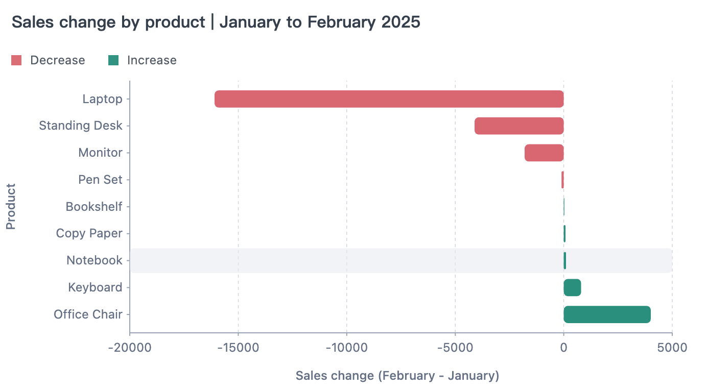

Start with a small, concrete task: give an agent some sales data, ask which products account for a drop in sales, and have it produce a short report with a chart.

To do that well, the agent needs to compare the overall change, break it down by product, and reconcile the totals. When something is unclear, it needs to run follow-up queries based on what it finds.

[AVA](https://ava.antv.vision) is an open-source data analysis and visualization framework for JavaScript applications and AI agents. **AVA executes the data operations; the agent uses the results to decide what to do next.**

In this tutorial, we'll use AVA and the AI SDK to build a Mini Data Agent with **53 lines of core code**.

## Prepare the data

Start with this [sales order dataset](https://github.com/antvis/AVA/blob/ai/__tests__/datasets/sales.csv), which contains 240 orders and 12 fields. Here are the order date, product, and sales amount for the first three orders:

| order_date | product | sales (after discounts) |
| ---------- | ------- | ----------------------: |
| 2025-01-01 | Monitor | 224.10 |
| 2025-01-02 | Office Chair | 680.20 |
| 2025-01-04 | Monitor | 2,191.20 |

`YOUR_DATA` is the array of objects parsed from the full CSV, with `sales` stored as a number.

## Define the business semantics

Next, tell the agent how to interpret the data: use sales amounts after discounts, assign each order to a month by its order date, and compare the increase or decrease in sales for each product.

AVA uses this semantic configuration when generating queries. It reduces guesswork about what a metric means and keeps follow-up questions consistent with the same business definitions.

```yaml
models:
  - name: data
    tableReference:
      table: data
    properties:
      description: Each row represents one order.
cubes:
  - name: sales
    baseObject: data
    measures:
      - name: total_sales
        expression: CAST(SUM(sales) AS DOUBLE)
        type: DOUBLE
        description: Sales after discounts, calculated by summing sales.
    dimensions:
      - name: product
        expression: product
        type: VARCHAR
    timeDimensions:
      - name: order_date
        expression: CAST(order_date AS DATE)
        type: DATE
    properties:
      description: |
        Compare both periods using the same set of products. Change is current-period sales minus prior-period sales; negative values indicate a decline.
        Change rate is change divided by prior-period sales. Return null when prior-period sales are zero, indicating that the rate is not applicable.
```

`YOUR_SEMANTIC` is the object parsed from this YAML. See [Business semantics](https://ava.antv.vision/documentation/data/semantic/) for details on the fields.

## Build the data agent

With the data and definitions in place, give the agent two tools: `analyze` queries and computes the data, while `visualize` takes a visualization request and data to generate a chart. `ToolLoopAgent` passes each tool result back to the model, which decides whether to continue the analysis, which results to send to `visualize`, or when to deliver its conclusions.

The example requires **Node.js 22.13.0 or later**. Install these dependencies:

```bash
npm install @antv/ava@4.0.0 ai@7.0.112 zod@4.6.7
```

`YOUR_MODEL` is a configured model instance that supports tool calling. Pass it in along with your data and semantic definitions, and the agent can use AVA to analyze the data:

```javascript
import { AVA } from '@antv/ava';
import { ToolLoopAgent, isStepCount, tool } from 'ai';
import { z } from 'zod';

async function createDataAgent({ model, data, semantic }) {
  const ava = new AVA({ llm: { model } });
  await ava.source({ type: 'json', options: { data } });
  await ava.semantic(undefined, () => semantic);

  const messages = [];
  let analysis;
  let chart;

  const agent = new ToolLoopAgent({
    model,
    instructions: `Analyze the user's task step by step, using conversation history to make each query self-contained.
    Use analyze to compute and verify data.
    For visualize, select relevant rows and fields from analyze results; never invent or change values.
    Base conclusions on tool results and state what data is missing when evidence is insufficient.`,
    stopWhen: isStepCount(8),
    providerOptions: { openai: { parallelToolCalls: false } },
    tools: {
      analyze: tool({
        description: 'Query and analyze data using a self-contained question.',
        inputSchema: z.object({ query: z.string() }),
        execute: async ({ query }) => {
          analysis = chart = undefined;
          analysis = await ava.analyze(query);
          return analysis;
        },
      }),
      visualize: tool({
        description: 'Generate a chart from the visualization request and data returned by analyze.',
        inputSchema: z.object({ query: z.string(), data: z.array(z.record(z.string(), z.unknown())) }),
        execute: async ({ query, data }) => {
          chart = await ava.visualize({ query, data });
          return { chartType: chart?.chartType };
        },
      }),
    },
  });

  return {
    async ask(question) {
      chart = undefined;
      messages.push({ role: 'user', content: question });
      const result = await agent.generate({ messages });
      messages.push(...result.responseMessages);
      return { text: result.text, analysis, chart };
    },
    dispose: () => ava.dispose(),
  };
}
```

The agent keeps the conversation and analysis history so you can ask follow-up questions. When it needs a chart, it selects the relevant rows and columns from the analysis results and passes them to `visualize` through the `data` parameter. It is not limited to the most recent analysis result. Now give it the task we started with:

```javascript
import { writeFile } from 'node:fs/promises';

const assistant = await createDataAgent({
  model: YOUR_MODEL,
  data: YOUR_DATA,
  semantic: YOUR_SEMANTIC,
});

try {
  const task = `Analyze the decline in sales from January to February 2025. List sales for each product in both months and the change,
sort by the size of the decline, reconcile the totals, and show the changes in a bar chart.`;
  const answer = await assistant.ask(task);
  console.log(answer.text);
  console.table(answer.analysis?.data);
  console.log(answer.analysis?.sql);
  if (answer.chart) await writeFile('chart.html', answer.chart.html);

  console.log((await assistant.ask('Did Laptop sales fall because a promotion ended?')).text);
} finally {
  await assistant.dispose();
}
```

## Review the results

For this task, the agent can first use `analyze` to compare the monthly totals, then break the decline down by product. It checks that the product-level changes add up to the overall change, uses `visualize` to draw a chart, and summarizes the findings. If the totals do not reconcile, it needs to query the data again and investigate.

Aggregating this dataset gives total sales of **38,897.18** in January and **21,804.11** in February, a decline of **43.94%**. The changes by product are:

| Product | January sales | February sales | Change (February − January) |
| ------- | ------------: | -------------: | --------------------------: |
| Laptop | 19,688.10 | 3,596.00 | −16,092.10 |
| Standing Desk | 9,655.80 | 5,546.10 | −4,109.70 |
| Monitor | 6,536.25 | 4,731.00 | −1,805.25 |
| Pen Set | 232.20 | 127.71 | −104.49 |
| Bookshelf | 1,225.50 | 1,251.30 | +25.80 |
| Copy Paper | 59.19 | 137.06 | +77.87 |
| Notebook | 31.50 | 137.03 | +105.53 |
| Keyboard | 215.64 | 1,015.31 | +799.67 |
| Office Chair | 1,253.00 | 5,262.60 | +4,009.60 |
| **Total** | **38,897.18** | **21,804.11** | **−17,093.07** |

The product-level changes sum to **−17,093.07**, matching the overall change. The chart makes the main contributors clear: **Laptop accounts for most of the decline, while growth in Office Chair sales offsets part of it.**



You might then ask, “Did Laptop sales fall because a promotion ended?” The available data does not include promotion dates or which products were covered, so the agent cannot confirm that explanation. **Identifying where sales declined is one step; explaining the business cause requires further evidence.**

To use this agent in your own business, replace the sample data and semantic definitions with yours, then give it a new analysis task.
