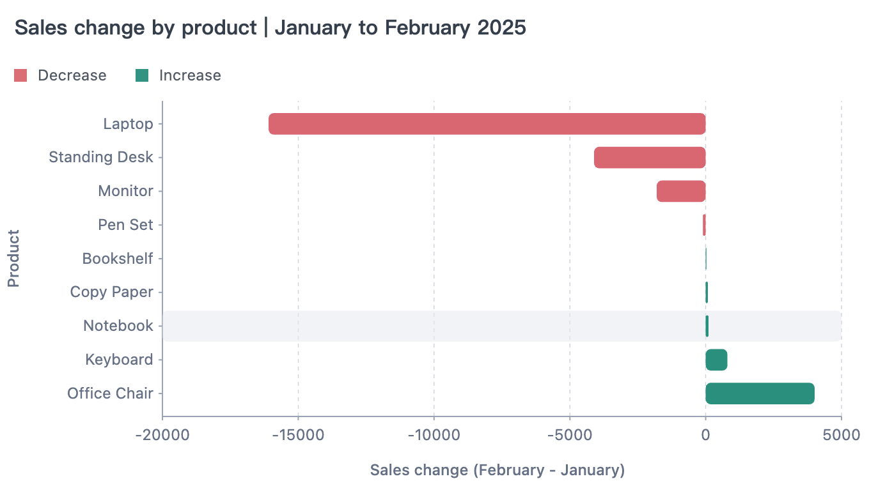

做一个 Data Agent，可以从一个很小的需求开始：给它一份销售数据，让它分析销售额下降主要来自哪些产品，并整理成一份带图表的简短报告。

完成这份报告，需要比较整体变化、按产品定位下降来源，并核对合计。遇到疑点时，再根据结果补充查询。

[AVA](https://ava.antv.vision) 是面向 JavaScript 应用和 AI Agent 的开源数据分析与可视化框架。**AVA 负责执行数据操作，Data Agent 负责根据结果组织下一步。**

本文用 AVA 和 AI SDK，通过 **53 行核心代码** 搭建一个 Mini Data Agent。

## 准备数据

先准备一份[销售订单数据](https://github.com/antvis/AVA/blob/ai/__tests__/datasets/sales.csv)，共 240 笔订单、12 个字段。下面列出前 3 笔订单的日期、产品和销售额：

| order_date（订单日期） | product（产品） | sales（折后销售额） |
| ---------------------- | --------------- | ------------------: |
| 2025-01-01             | Monitor         |              224.10 |
| 2025-01-02             | Office Chair    |              680.20 |
| 2025-01-04             | Monitor         |            2,191.20 |

`YOUR_DATA` 表示完整 CSV 解析得到的对象数组，其中 `sales` 为数值。

## 定义语义

接着，告诉 Agent 这些数据该怎么算：销售额按折后金额统计，月份以下单时间为准，再比较各产品的销售额增加或减少了多少。

语义配置会把这些约定作为 AVA 生成查询的依据，减少模型对指标含义的猜测，也让后续追问沿用同一套口径。

```yaml
models:
  - name: data
    tableReference:
      table: data
    properties:
      description: Each row represents one order.
cubes:
  - name: sales
    baseObject: data
    measures:
      - name: total_sales
        expression: CAST(SUM(sales) AS DOUBLE)
        type: DOUBLE
        description: Sales after discounts, calculated by summing sales.
    dimensions:
      - name: product
        expression: product
        type: VARCHAR
    timeDimensions:
      - name: order_date
        expression: CAST(order_date AS DATE)
        type: DATE
    properties:
      description: |
        Compare both periods using the same set of products. Change is current-period sales minus prior-period sales; negative values indicate a decline.
        Change rate is change divided by prior-period sales. Return null when prior-period sales are zero, indicating that the rate is not applicable.
```

`YOUR_SEMANTIC` 表示这段 YAML 解析后的对象。字段用法见[业务语义](https://ava.antv.vision/zh/documentation/data/semantic/)。

## 构建 Data Agent

数据和口径准备好后，为 Agent 提供两个工具：`analyze` 查询和计算数据，`visualize` 接收绘图要求和数据，生成图表。`ToolLoopAgent` 把每次执行结果交回模型，让它决定继续分析、选择哪些结果传给 `visualize`，还是交付结论。

示例使用 **Node.js 22.13.0 或更高版本**，安装以下依赖：

```bash
npm install @antv/ava@4.0.0 ai@7.0.112 zod@4.6.7
```

`YOUR_MODEL` 是已配置好、支持工具调用的模型实例。将它与数据、语义一起传入，Agent 就能调用 AVA 开展分析：

```javascript
import { AVA } from '@antv/ava';
import { ToolLoopAgent, isStepCount, tool } from 'ai';
import { z } from 'zod';

async function createDataAgent({ model, data, semantic }) {
  const ava = new AVA({ llm: { model } });
  await ava.source({ type: 'json', options: { data } });
  await ava.semantic(undefined, () => semantic);

  const messages = [];
  let analysis;
  let chart;

  const agent = new ToolLoopAgent({
    model,
    instructions: `Analyze the user's task step by step, using conversation history to make each query self-contained.
    Use analyze to compute and verify data.
    For visualize, select relevant rows and fields from analyze results; never invent or change values.
    Base conclusions on tool results and state what data is missing when evidence is insufficient.`,
    stopWhen: isStepCount(8),
    providerOptions: { openai: { parallelToolCalls: false } },
    tools: {
      analyze: tool({
        description: 'Query and analyze data using a self-contained question.',
        inputSchema: z.object({ query: z.string() }),
        execute: async ({ query }) => {
          analysis = chart = undefined;
          analysis = await ava.analyze(query);
          return analysis;
        },
      }),
      visualize: tool({
        description: 'Generate a chart from the visualization request and data returned by analyze.',
        inputSchema: z.object({ query: z.string(), data: z.array(z.record(z.string(), z.unknown())) }),
        execute: async ({ query, data }) => {
          chart = await ava.visualize({ query, data });
          return { chartType: chart?.chartType };
        },
      }),
    },
  });

  return {
    async ask(question) {
      chart = undefined;
      messages.push({ role: 'user', content: question });
      const result = await agent.generate({ messages });
      messages.push(...result.responseMessages);
      return { text: result.text, analysis, chart };
    },
    dispose: () => ava.dispose(),
  };
}
```

Agent 会保留对话和分析记录，方便继续追问。绘图时，它从分析结果中选择需要展示的行和列，通过 `data` 参数传给 `visualize`，不局限于最近一次分析结果。现在把开头的需求交给它：

```javascript
import { writeFile } from 'node:fs/promises';

const assistant = await createDataAgent({
  model: YOUR_MODEL,
  data: YOUR_DATA,
  semantic: YOUR_SEMANTIC,
});

try {
  const task = `分析 2025 年 2 月较 1 月的销售额下降来源，列出各产品两个月的销售额和变化额，
按降幅排序、核对合计，并用条形图展示变化额。`;
  const answer = await assistant.ask(task);
  console.log(answer.text);
  console.table(answer.analysis?.data);
  console.log(answer.analysis?.sql);
  if (answer.chart) await writeFile('chart.html', answer.chart.html);

  console.log((await assistant.ask('Laptop 销售额下降是因为促销结束了吗？')).text);
} finally {
  await assistant.dispose();
}
```

## 查看结果

以这个任务为例，Agent 可以先用 `analyze` 比较两个月的总额，看到下降后再按产品拆解；核对各产品的变化额合计与整体一致，再用 `visualize` 画图并整理结论。如果合计对不上，就需要继续查询核对。

按这份数据汇总，销售额从 1 月的 **38,897.18** 降至 2 月的 **21,804.11**，下降 **43.94%**。各产品的变化如下：

| 产品          |    1 月销售额 |    2 月销售额 | 变化额（2 月 − 1 月） |
| ------------- | ------------: | ------------: | --------------------: |
| Laptop        |     19,688.10 |      3,596.00 |            −16,092.10 |
| Standing Desk |      9,655.80 |      5,546.10 |             −4,109.70 |
| Monitor       |      6,536.25 |      4,731.00 |             −1,805.25 |
| Pen Set       |        232.20 |        127.71 |               −104.49 |
| Bookshelf     |      1,225.50 |      1,251.30 |                +25.80 |
| Copy Paper    |         59.19 |        137.06 |                +77.87 |
| Notebook      |         31.50 |        137.03 |               +105.53 |
| Keyboard      |        215.64 |      1,015.31 |               +799.67 |
| Office Chair  |      1,253.00 |      5,262.60 |             +4,009.60 |
| **合计**      | **38,897.18** | **21,804.11** |        **−17,093.07** |

各产品的变化额合计为 **−17,093.07**，与整体变化一致。画成图后，下降的来源更加清楚：**Laptop 是主要拖累，Office Chair 的增长则抵消了部分下降。**



接下来可以追问：“Laptop 销售额下降是因为促销结束了吗？”现有数据缺少活动时间和参与范围，还不能确认。**定位下降来源之后，解释业务原因还需要证据。**

接入自己的业务时，换成相应的数据和业务口径，再交给它新的分析任务即可。
