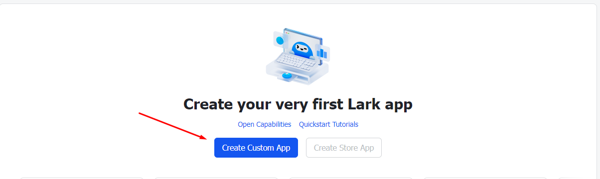
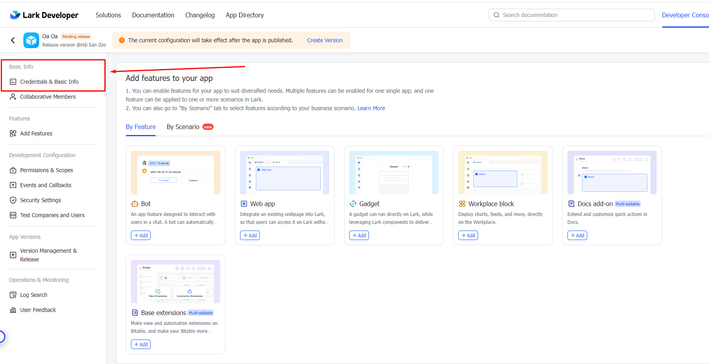
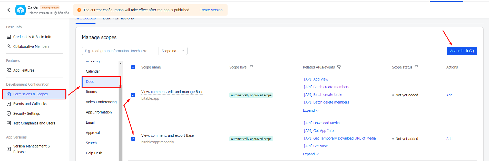
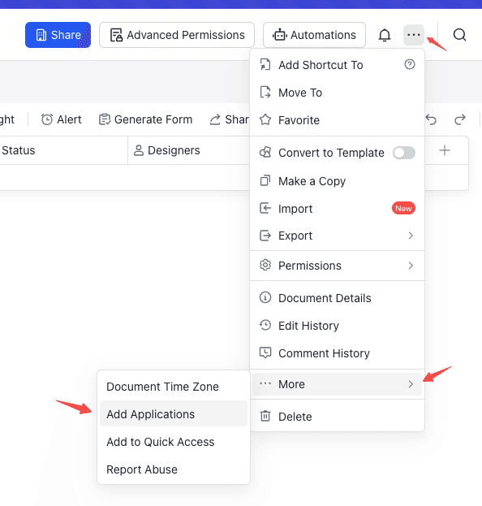
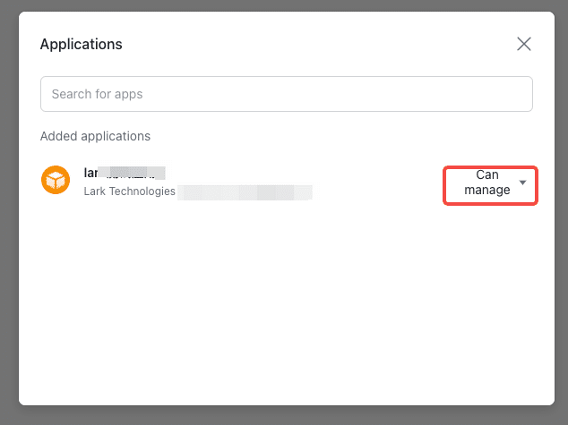

import { Heading } from '../../../../mdx-components';

Create a Lark app, grant access to your Base, and load its data into AVA. Once connected, query it with the CLI or Node.js SDK, or use the [Agent Skill](/documentation/agent-skill/) to analyze the data and generate charts.

<Heading as="h2" id="before-you-start">Before you start</Heading>

- A Lark account that can create an enterprise custom app, and permission to manage the target Base. Ask your administrator or document owner to complete any required approvals.
- **Node.js 22.13.0 or later**. The CLI currently supports macOS / Linux; see the [CLI guide](/documentation/reference/cli/) for installation.
- The browser URL of the target table, usually containing `/base/` or `/wiki/`.

AVA reads as the app and loads records into a read-only view named `data` using the Node.js DuckDB engine. Loading, inspecting the schema, and running SQL do not require a model API key. Configure a model for AVA's natural-language analysis and visualization as described in [Model configuration](/documentation/configuration/).

Click any screenshot to view it at full size.

<Heading as="h2" id="create-an-app">1. Create an app and get credentials</Heading>

1. Open the developer console on the [Lark Open Platform](https://open.larksuite.com/) and create an **enterprise custom app**, or reuse an existing one.
2. Enter a name and description, such as “AVA analytics”.
3. Find **App ID** and **App Secret** on the app's **Credentials & Basic Info** page for the binding step below.

App ID identifies the Open Platform app; App Secret authenticates it to obtain a `tenant_access_token`. These are different from the App Token in a Base URL. AVA obtains the access token automatically, so you do not need to copy one manually.

<figure>
  <a href="/screenshots/lark/create-app.webp" target="_blank" rel="noopener noreferrer">
    
  </a>
  <figcaption>Select <strong>Create Custom App</strong> to begin.</figcaption>
</figure>

<figure>
  <a href="/screenshots/lark/credentials.webp" target="_blank" rel="noopener noreferrer">
    
  </a>
  <figcaption>Open <strong>Credentials & Basic Info</strong> to find your app credentials.</figcaption>
</figure>

<Heading as="h2" id="grant-access">2. Enable permissions and grant document access</Heading>

<Heading as="h3" id="api-permissions">Open Platform: allow the app to call read APIs</Heading>

In **Permissions & Scopes**, search for Base and request permissions to read tables, fields, and records. Follow the permission requirements in Lark's API documentation. AVA calls the following read endpoints:

<figure>
  <a href="/screenshots/lark/api-permissions.webp" target="_blank" rel="noopener noreferrer">
    
  </a>
  <figcaption>Use <strong>Permissions & Scopes</strong> to find the read scopes required by the endpoints below. The <strong>Create Version</strong> button opens the release form.</figcaption>
</figure>

| Endpoint | Purpose | When required |
| --- | --- | --- |
| `GET /open-apis/bitable/v1/apps/{app_token}/tables/{table_id}/fields` | Read field names and types | Every load |
| `GET /open-apis/bitable/v1/apps/{app_token}/tables/{table_id}/records` | Read records | Every load |
| `GET /open-apis/bitable/v1/apps/{app_token}/tables` | Find the target table | When the URL has no `table` parameter |
| `GET /open-apis/wiki/v2/spaces/get_node` | Resolve a Wiki node to its Base | For `/wiki/` URLs; also request Wiki read permissions |

See the [Lark Base API documentation](https://open.larksuite.com/document/server-docs/docs/bitable-v1/overview). Create and publish a version under **Version Management & Release** after requesting permissions. Wait for administrator approval when required, and confirm the permissions have taken effect.

<Heading as="h3" id="document-access">Base: allow the app to read the target document</Heading>

1. In the target Base, open the top-right **···** menu and choose **More → Add Applications**. The entry may also appear as **Add Document App**.
2. Search for and add the app you created, granting read access. If the entry or app is unavailable, ask the document owner to check document permissions, app publication, and availability.
3. If advanced permissions are enabled, confirm the app can read the tables, records, and fields you want to analyze.
4. For a `/wiki/` URL, also grant the app access to the corresponding Wiki space through its access settings. Base permissions alone do not allow Wiki node resolution.

<figure>
  <a href="/screenshots/lark/document-menu.png" target="_blank" rel="noopener noreferrer">
    
  </a>
  <figcaption>Open <strong>More → Add Applications</strong> in the target Base.</figcaption>
</figure>

<figure>
  <a href="/screenshots/lark/document-access.png" target="_blank" rel="noopener noreferrer">
    
  </a>
  <figcaption>Use the dropdown next to the added app to check its access. The example shows <strong>Can manage</strong>. Choose read access for AVA.</figcaption>
</figure>

<Heading as="h2" id="copy-the-link">3. Copy the target table URL</Heading>

Select the table you want to analyze, then copy the full URL from the browser address bar, keeping the `table` parameter:

```text
https://my.larksuite.com/base/APP_TOKEN?table=TABLE_ID&view=VIEW_ID
https://my.larksuite.com/wiki/NODE_TOKEN?table=TABLE_ID&view=VIEW_ID
```

| URL value | Configuration | Meaning |
| --- | --- | --- |
| `APP_TOKEN` after `/base/` | `appToken` | Base identifier, distinct from App ID |
| `NODE_TOKEN` after `/wiki/` | Keep it in `url` | Wiki node identifier; AVA resolves the actual App Token. Do not use the node token as `appToken`. |
| `table=TABLE_ID` | `tableId` | Target table identifier |
| `view=VIEW_ID` | None | Ignored by AVA |

Without `table`, AVA tries to discover the table: it uses the only table when there is one, or reports candidate names and IDs when there are several. Specify `table` or `tableId` and reload. Lark `/docx/`, `/sheets/`, and Wiki nodes hosting other document types are not supported by this source.

<Callout>
  AVA loads the entire table accessible to the app, paginating through fields and records. Base view filters are not applied.
  A view showing only this month's records will not limit the loaded data, even if its `view` parameter is present. Add the filter explicitly in SQL.
</Callout>

Always pass the full Lark URL in `url`. AVA uses its `larksuite.com` domain to select the Lark API. When you supply only `appToken` and `tableId`, AVA defaults to the Feishu China API.

<Heading as="h2" id="bind-and-load">4. Bind credentials and load data</Heading>

<Heading as="h3" id="terminal-binding">Option 1: first-time terminal binding</Heading>

Install the CLI and run the following in an interactive terminal, replacing the URL with your actual table URL:

```bash
npm install -g @antv/ava@latest
ava source "https://my.larksuite.com/base/APP_TOKEN?table=TABLE_ID"
```

If credentials are not configured, AVA prompts for App ID and App Secret. The secret is not echoed. Successful binding saves credentials to the current user's `~/.ava/feishu.json` for later loads. Binding only verifies that the app can obtain a token; document access is checked during the subsequent load.

```text
App ID: cli_YOUR_APP_ID
App Secret:
```

<Heading as="h3" id="environment-variables">Option 2: environment variables</Heading>

Set these variables in your macOS / Linux shell. For automation, use the runtime's secret configuration.

```bash
export AVA_FEISHU_APP_ID='YOUR_APP_ID'
export AVA_FEISHU_APP_SECRET='YOUR_APP_SECRET'
ava source "https://my.larksuite.com/base/APP_TOKEN?table=TABLE_ID"
```

<Heading as="h3" id="source-config">Option 3: source configuration file</Heading>

Save the following as `lark-source.json`. This file specifies the source only; credentials can still come from environment variables or saved binding information.

```json
{
  "type": "feishu-bitable",
  "options": {
    "url": "https://my.larksuite.com/base/APP_TOKEN?table=TABLE_ID"
  }
}
```

```bash
ava source @lark-source.json
```

| Configuration field | Required | Description |
| --- | --- | --- |
| `url` | Yes for Lark | Full Base or Wiki URL on `larksuite.com` |
| `appToken` | No | Base App Token, if supplied alongside the URL |
| `tableId` | No | Target table ID. Supply it if the URL omits `table` and the Base has multiple tables. |
| `appId` | SDK: yes; CLI: can be resolved elsewhere | Open Platform App ID |
| `appSecret` | SDK: yes; CLI: can be resolved elsewhere | Open Platform App Secret |

When both `url` and `appToken` / `tableId` are supplied, they must identify the same table.

CLI credential priority is **configuration `appId` + `appSecret` → environment variables → `~/.ava/feishu.json` → interactive terminal binding**. A partial pair in either of the first two sources causes an error; credentials from different sources are not combined. Piped input, redirection, and other non-interactive environments do not prompt for binding, so configure credentials beforehand.

Keep App Secret and the saved binding file out of Git and logs. To change a saved app, update the complete credential pair in the binding file, or override it with higher-priority environment variables.

<Heading as="h2" id="verify-the-data">5. Verify the data and start analysis</Heading>

A successful load returns a dataset ID. Replace `YOUR_DATASET_ID` with that actual value to inspect the schema, sample rows, and record count:

```bash
ava schema YOUR_DATASET_ID
ava query YOUR_DATASET_ID --dsl 'SELECT * FROM data LIMIT 5'
ava query YOUR_DATASET_ID --dsl 'SELECT COUNT(*) AS row_count FROM data'
```

Check the `data` view, field names, and read scope. The count should match the target table accessible to the app. Run `ava dispose YOUR_DATASET_ID` when finished. After changes in Base, run `ava source` again and use the new ID; existing sessions do not continuously synchronize remote changes.

Complex fields such as people, attachments, and linked records become queryable text, usually with multiple values separated by commas. Attachments expose metadata without downloading files. Formula and lookup fields are converted according to their returned value types and are not necessarily text. Unsupported field types are skipped; an empty table preserves supported field definitions.

After installing the [AVA Skill](/documentation/agent-skill/), you can ask your agent:

```text
Use AVA Skill to analyze this Lark Base: <replace with the full URL>.
Credentials are configured locally. Inspect the schema and verify the record count,
then count records by department using the actual fields.
Provide the query, results, and a chart. Make any time filters explicit in the query.
```

<Heading as="h2" id="nodejs-sdk">Use the Node.js SDK</Heading>

Pass credentials explicitly to the SDK; it does not automatically read the CLI binding file or environment variables. This example reads environment variables in application code and runs queries without calling a model:

```javascript
import { AVA } from '@antv/ava';

const ava = new AVA({
  llm: { model: 'gpt-4o-mini' },
  engine: { type: 'duckdb' },
});

try {
  await ava.source({
    type: 'feishu-bitable',
    options: {
      url: 'https://my.larksuite.com/base/APP_TOKEN?table=TABLE_ID',
      appId: process.env.AVA_FEISHU_APP_ID,
      appSecret: process.env.AVA_FEISHU_APP_SECRET,
    },
  });
  console.log(await ava.schema());
  console.log(await ava.query('SELECT COUNT(*) AS row_count FROM data'));
} finally {
  await ava.dispose();
}
```

<Heading as="h2" id="troubleshooting">Troubleshooting</Heading>

| Symptom | Check and resolution |
| --- | --- |
| App binding fails | Check that App ID and App Secret belong to the same enterprise custom app, are copied in full, and belong to the Lark tenant hosting your Base. The error preserves the platform's code and message. |
| Binding succeeds but loading reports insufficient permissions | Confirm read API permissions are published and effective, and the same app is added to the target document. Your own access does not grant app access. |
| `/base/` works but `/wiki/` fails | Check Wiki read API permissions, space access, and whether the node hosts a Base. |
| Error contains `has … tables` | Specify `?table=TABLE_ID` or `tableId`; do not use a view ID as a table ID. |
| Error contains `does not match` | Remove redundant identifiers or ensure `url`, `appToken`, and `tableId` identify the same table. |
| Missing credentials in a non-interactive environment | Configure paired environment variables, a complete source configuration, or a saved binding file beforehand. |
| `~/.ava/feishu.json is not valid JSON` | Repair the file to valid JSON containing `appId` and `appSecret`, or override it with environment variables. |
| More records than the view shows, or remote changes are missing | `view` filters are ignored; filter in SQL. Reload the source to read remote updates. |
| Network error or non-JSON response | Check connectivity and proxy settings for `open.larksuite.com`, and inspect the original failing request. |

See the [CLI guide](/documentation/reference/cli/) for complete commands and [Data sources](/documentation/data/sources/) for other connectors.

Screenshot references include [LadiPage’s Lark Base setup guide](https://helpv3.ladipage.vn/form-data/cac-buoc-cai-dat-luu-data/luu-data-ve-lark-base/cach-tao-app-va-lay-cac-thong-tin-ket-noi-cua-lark-base) and the [Lark AnyCross Base archiving tutorial](https://note.com/hiroshikinoshita/n/ndcf1b853e7f5).
