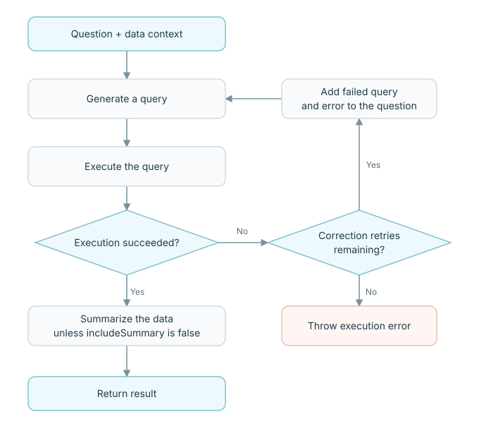
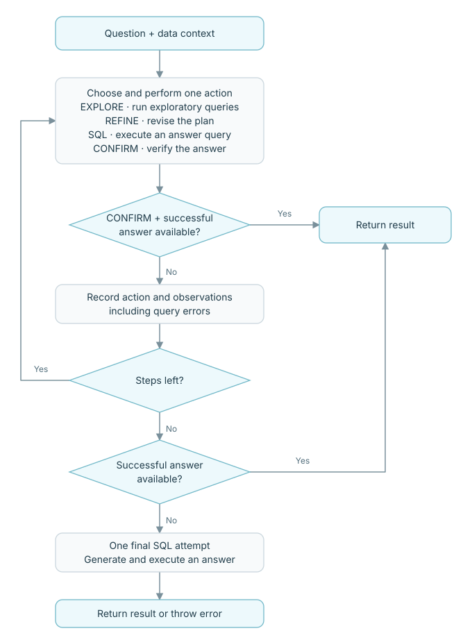

import { Heading } from '../../../../mdx-components';

AVA 可以用直接查询或多步推理循环回答问题。下面的示例假定 `ava` 已经加载数据源，配置方式见[分析数据](/documentation/analysis/overview/)。

<Heading as="h2" id="choose-a-strategy">选择策略</Heading>

可以为每次 `analyze()` 调用选择策略：

| 策略 | 执行方式 | 适用情况 |
| -------- | ---------------------------------------------------------------------------------------------------------- | ----------------------------------------------------- |
| `direct` | 生成查询、执行，再按需总结。执行失败时可以修正查询并重试。 | 问题明确时，从这里开始。 |
| `loop` | 多步探索、推理和查询后再返回答案。 | 需要中间探索才能回答的问题。 |

<Heading as="h2" id="strategy-options">策略选项</Heading>

所有策略选项都放在 `config.strategy` 中：

| 字段 | 类型 | 必填 | 默认值与行为 |
| ------------ | ----------------------------------- | --------------------------- | --------------------------------------------------------------------------------- |
| `type` | `'direct'` 或 `'loop'` | 提供 `strategy` 时必填 | 选择策略。 |
| `maxRetries` | `number` | 否，仅 `direct` | 显式指定 `type: 'direct'` 时，首次尝试后默认最多修正重试 `2` 次。 |
| `maxSteps` | `number` | 否，仅 `loop` | 默认允许 `12` 个常规推理步骤。 |

<Heading as="h2" id="direct">Direct：直接分析</Heading>

结合问题和数据上下文生成查询，执行后按需总结返回数据。只有 **执行失败** 才会进入修正循环。

<figure
  className="docs-strategy-flow"
  tabIndex={0}
  aria-label="直接分析流程图；窄屏下可横向滚动"
>
  
</figure>

```typescript
const result = await ava.analyze('What is total revenue by region?', {
  strategy: { type: 'direct', maxRetries: 2 },
});
```

这份配置允许首次执行失败后再修正两次。当前实现中，如果完全省略 `strategy`，默认直接分析路径允许 **10** 次修正重试。建议显式设置以控制预算。模型 API 的重试单独由 `llm.maxRetries` 控制，默认为 `3`。

查询生成和总结阶段的错误直接向调用方抛出，不会重新进入执行修正循环。`includeSummary: false` 时，返回结果的 `text` 为空字符串。

<Heading as="h2" id="loop">Loop：多步分析</Heading>

每一步，模型根据问题、数据上下文与累计历史选择一个动作。探索并非必经步骤；信息足够时，可以直接生成用于回答问题的查询。

<figure
  className="docs-strategy-flow"
  tabIndex={0}
  aria-label="多步分析流程图；窄屏下可横向滚动"
>
  
</figure>

| 动作 | 做什么 | 后续处理 |
| --------- | ----------------------------------------------------------------------------------- | ----------------------------------------------------------------------------------------- |
| `EXPLORE` | 执行一个或多个探索查询，检查值、格式或关系。 | 将结果或执行错误加入历史，供下一步参考。 |
| `REFINE` | 调整理解与计划，不执行查询。 | 将计划加入历史，继续下一步。 |
| `SQL` | 使用当前引擎语言执行一个候选答案查询。 | 保存成功结果，或记录执行错误，供后续步骤修正。 |
| `CONFIRM` | 检查已执行的结果能否回答问题。 | 有结果时返回已保存的结果，否则继续循环。 |

即使引擎执行的不是 SQL，动作标签仍叫 `SQL`。这些动作由模型选择，不是固定的四步流水线。

```typescript
const result = await ava.analyze('Compare regional revenue and explain the differences', {
  strategy: { type: 'loop', maxSteps: 6 },
});
```

`maxSteps` 只限制常规推理步骤。达到上限时，如果已有成功答案，AVA 直接返回，不再强制执行一次 `CONFIRM`；若没有成功结果，则结合完整历史， **额外尝试一次查询生成与执行** 。这次最终尝试成功后直接返回，失败则抛错。

常规循环中的执行错误会成为下一步的反馈；模型调用失败或动作响应无效则会终止分析。模型 API 的重试仍遵循 `llm.maxRetries`，因此 `maxSteps` 不是模型调用总次数的严格上限。

常规 `CONFIRM` 路径下，`text` 包含验证说明与结论。达到步数上限或完成最终尝试时，优先使用之前的确认内容；没有则将结果数据序列化为 JSON。`includeSummary: false` 时 `text` 始终为空；Loop 不会额外调用独立的总结步骤。
