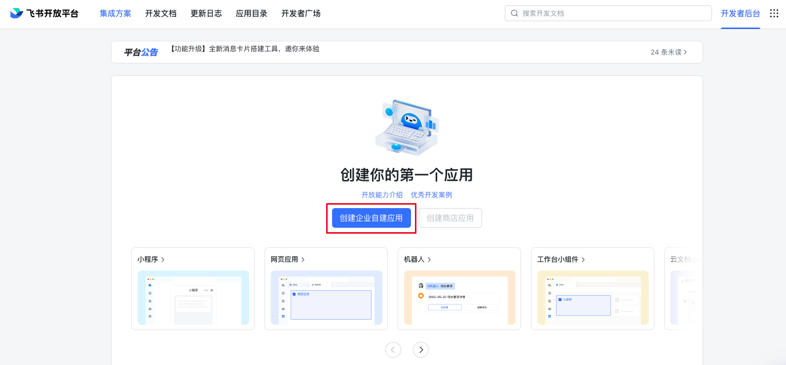
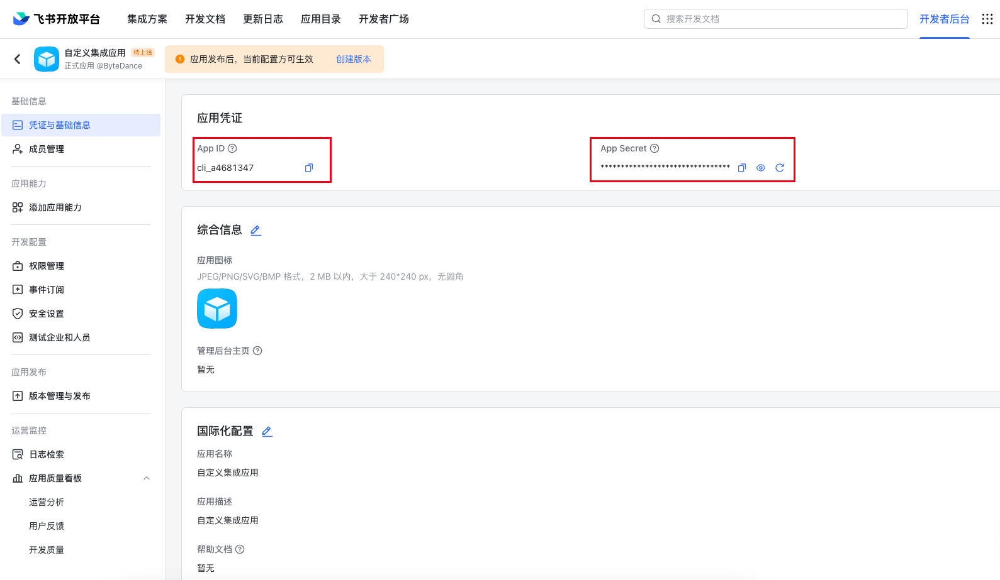
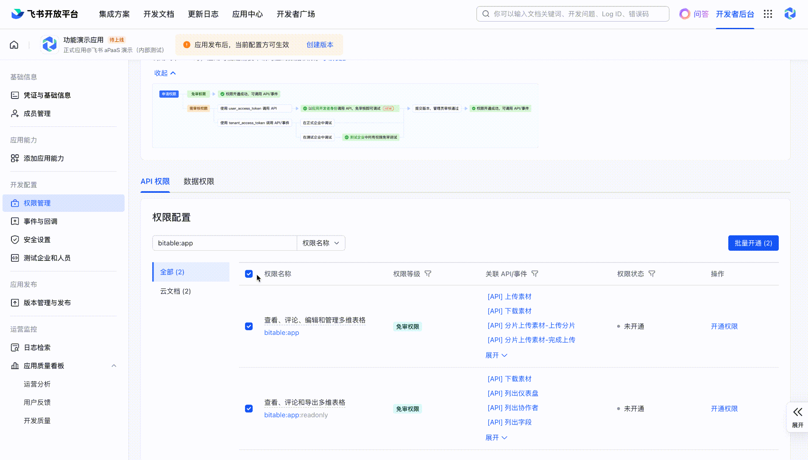
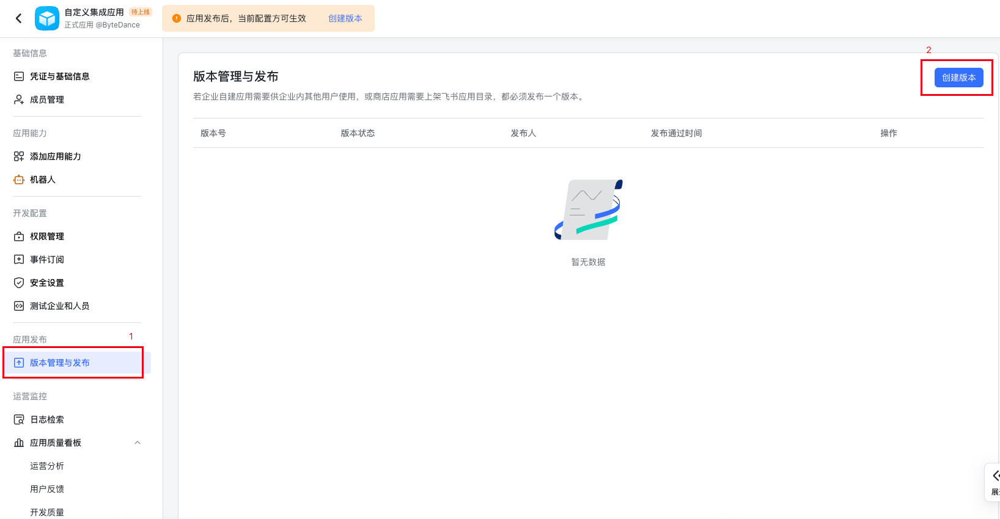
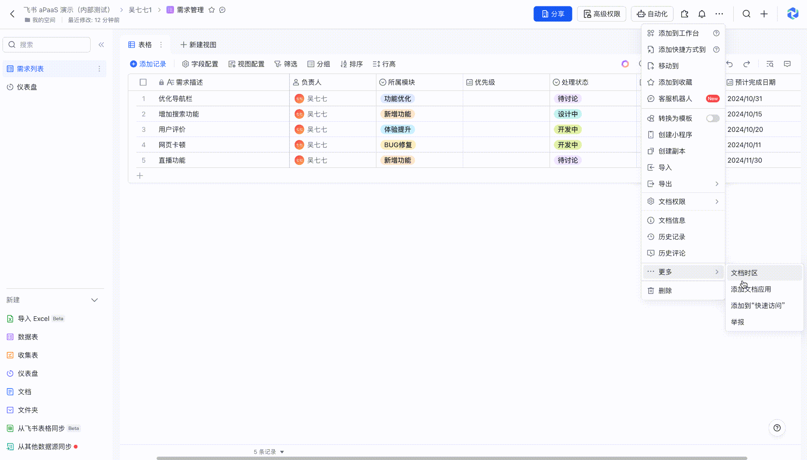
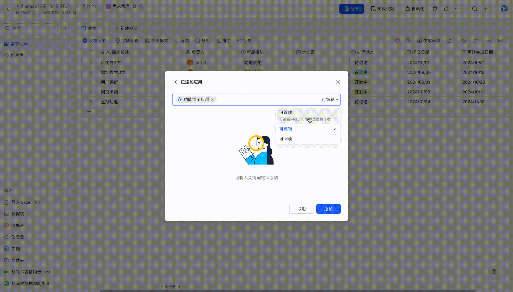

import { Heading } from '../../../../mdx-components';

这篇指南带你创建飞书应用、授予数据访问权限，再把多维表格接入 AVA。完成后，可以通过 CLI 或 Node.js SDK 查询数据，也可以交给 [Agent Skill](/documentation/agent-skill/)继续分析和生成图表。

<Heading as="h2" id="before-you-start">开始前准备</Heading>

- 一个允许创建企业自建应用的飞书账号，以及目标多维表格的管理权限；需要审批时，请联系企业管理员或表格所有者。
- **Node.js 22.13.0 或更高版本**。CLI 当前支持 macOS / Linux，安装方式见[命令行工具](/documentation/reference/cli/)。
- 目标数据表的浏览器地址，通常包含 `/base/` 或 `/wiki/`。

AVA 使用应用身份读取数据，在 Node.js 的 DuckDB 引擎中将记录加载为名为 `data` 的只读视图。加载、查看结构和执行 SQL 不需要模型 API 密钥；使用 AVA 的自然语言分析与可视化功能时，再按[模型配置](/documentation/configuration/)设置模型。

以下使用飞书官方教程中的真实界面截图，点击图片可查看原图。截图中的应用名称仅为示例，请使用你自己的应用；界面布局可能随飞书版本更新。

<Heading as="h2" id="create-an-app">1. 创建应用并获取凭证</Heading>

1. 打开[飞书开放平台](https://open.feishu.cn/)，进入开发者后台，创建 **企业自建应用**；已有应用也可以复用。
2. 填写应用名称和描述，例如「AVA 数据分析」。
3. 在应用的 **凭证与基础信息** 页面找到 **App ID** 和 **App Secret**，供后续绑定使用。

这里的 App ID 标识开放平台应用，App Secret 用来获取 `tenant_access_token`。它们与多维表格链接中的 App Token 是不同的值，不能互相替代。AVA 会自动获取访问令牌，无需手动复制令牌。

<figure>
  <a href="/screenshots/feishu/create-app.webp" target="_blank" rel="noopener noreferrer" aria-label="开发者后台的创建企业自建应用按钮">
    
  </a>
  <figcaption>在开发者后台点击「创建企业自建应用」，再填写应用名称、描述和图标。</figcaption>
</figure>

<figure>
  <a href="/screenshots/feishu/credentials.webp" target="_blank" rel="noopener noreferrer" aria-label="凭证与基础信息页面中的 App ID 和已隐藏的 App Secret">
    
  </a>
  <figcaption>创建后进入「凭证与基础信息」，复制自己的 App ID 和 App Secret。</figcaption>
</figure>

<Heading as="h2" id="grant-access">2. 开通权限并授权表格</Heading>

<Heading as="h3" id="api-permissions">开放平台：允许应用调用读取接口</Heading>

在应用的 **权限管理** 中搜索多维表格，申请能够读取数据表、字段和记录的权限。以飞书当前接口文档列出的权限要求为准；下面列出了 AVA 实际会调用的读取接口，便于逐项核对。

<figure>
  <a href="/screenshots/feishu/api-permissions.webp" target="_blank" rel="noopener noreferrer" aria-label="权限管理中搜索 bitable:app 后的多维表格权限列表">
    
  </a>
  <figcaption>在「权限管理」中搜索多维表格相关权限。截图演示搜索入口，不必照抄全选；按下表接口申请所需读取权限。</figcaption>
</figure>

| 接口 | 用途 | 何时需要 |
| --- | --- | --- |
| `GET /open-apis/bitable/v1/apps/{app_token}/tables/{table_id}/fields` | 读取字段名称和类型 | 每次加载 |
| `GET /open-apis/bitable/v1/apps/{app_token}/tables/{table_id}/records` | 读取记录 | 每次加载 |
| `GET /open-apis/bitable/v1/apps/{app_token}/tables` | 查找数据表 | 链接没有 `table` 参数时 |
| `GET /open-apis/wiki/v2/spaces/get_node` | 将知识库节点解析为多维表格 | 使用 `/wiki/` 链接时，额外申请知识库读取权限 |

参考[飞书服务端 API 文档](https://open.feishu.cn/document/server-docs/docs/bitable-v1/overview)。申请后，在 **版本管理与发布** 中创建版本并发布；如果企业要求管理员审批，等待审批完成，确认权限已生效。

<figure>
  <a href="/screenshots/feishu/publish-version.webp" target="_blank" rel="noopener noreferrer" aria-label="版本管理与发布页面的创建版本按钮">
    
  </a>
  <figcaption>开通权限后，在「版本管理与发布」中点击「创建版本」，填写版本信息并提交发布。</figcaption>
</figure>

<Heading as="h3" id="document-access">多维表格：允许应用访问目标文档</Heading>

1. 打开目标多维表格，在右上角的 **更多** 或文档应用入口中找到 **添加文档应用**；具体入口名称以当前飞书界面为准。
2. 搜索并添加刚创建的应用，使其获得读取目标表格的权限。若入口不可用或找不到应用，让表格所有者检查文档权限与应用的发布状态、可用范围。
3. 表格启用了高级权限时，确认应用可以读取要分析的数据表、记录和字段。
4. 使用知识库中的 `/wiki/` 链接时，还需要为应用授予相应知识空间的访问权限，按知识空间设置添加应用。仅有多维表格权限不足以解析 Wiki 节点。

<figure>
  <a href="/screenshots/feishu/document-menu.webp" target="_blank" rel="noopener noreferrer" aria-label="多维表格右上角更多菜单中的添加文档应用入口">
    
  </a>
  <figcaption>在目标多维表格中打开「··· → 更多 → 添加文档应用」。</figcaption>
</figure>

<figure>
  <a href="/screenshots/feishu/document-access.webp" target="_blank" rel="noopener noreferrer" aria-label="添加文档应用弹窗中的应用及可阅读权限选项">
    
  </a>
  <figcaption>搜索并选择自己的应用，设置能够读取目标表格的权限，再点击「添加」。截图展示权限选项；读取场景可选择「可阅读」。</figcaption>
</figure>

<Heading as="h2" id="copy-the-link">3. 复制目标数据表链接</Heading>

在多维表格中切换到要分析的数据表，复制浏览器地址栏中的完整链接，并保留 `table` 参数。例如：

```text
https://my.feishu.cn/base/APP_TOKEN?table=TABLE_ID&view=VIEW_ID
https://my.feishu.cn/wiki/NODE_TOKEN?table=TABLE_ID&view=VIEW_ID
```

| 链接中的值 | 对应配置 | 含义 |
| --- | --- | --- |
| `/base/` 后的 `APP_TOKEN` | `appToken` | 多维表格标识，不是 App ID |
| `/wiki/` 后的 `NODE_TOKEN` | 放在 `url` 中 | 知识库节点标识；AVA 自动解析实际 App Token，不能直接用作 `appToken` |
| `table=TABLE_ID` | `tableId` | 当前数据表标识 |
| `view=VIEW_ID` | 无 | AVA 会忽略这个参数 |

缺少 `table` 参数时，AVA 会尝试查找数据表：只有一张表就自动使用；有多张表则报错并列出候选表名和 ID，需要指定 `table` 或 `tableId` 后重新加载。飞书文档 `/docx/`、电子表格 `/sheets/` 和知识库中的其他文档类型不支持作为该数据源加载。

<Callout>
  AVA 加载的是应用可读取的整张数据表，按接口分页读取字段和记录，不会应用飞书视图中的筛选条件。
  例如某个视图只显示本月记录，带上它的 `view` 参数也不会把 AVA 的数据限制为本月；请在 SQL 中明确筛选。
</Callout>

Lark 国际版同样支持 `larksuite.com` 下的 `/base/` 和 `/wiki/` 链接，使用 [Lark 开放平台](https://open.larksuite.com/)创建的应用。AVA 根据链接域名自动选择接口服务；使用 Lark 时请保留 `url`，仅提供 `appToken` / `tableId` 会默认访问飞书中国版接口。

<Heading as="h2" id="bind-and-load">4. 绑定凭证并加载</Heading>

<Heading as="h3" id="terminal-binding">方式一：在终端中首次绑定</Heading>

安装 CLI 后，把示例链接替换成实际链接，在交互终端执行：

```bash
npm install -g @antv/ava@4
ava source "https://my.feishu.cn/base/APP_TOKEN?table=TABLE_ID"
```

没有配置凭证时，AVA 会提示输入 App ID 和 App Secret。App Secret 输入时不回显；绑定成功后，凭证保存到当前用户的 `~/.ava/feishu.json`，以后加载时可以复用。绑定只验证应用凭证能否获取令牌，目标表格的访问权限会在随后加载时验证。

```text
App ID: cli_YOUR_APP_ID
App Secret:
```

<Heading as="h3" id="environment-variables">方式二：使用环境变量</Heading>

在 macOS / Linux 的 shell 中设置以下变量；自动化任务则使用运行环境的密钥管理配置。

```bash
export AVA_FEISHU_APP_ID='YOUR_APP_ID'
export AVA_FEISHU_APP_SECRET='YOUR_APP_SECRET'
ava source "https://my.feishu.cn/base/APP_TOKEN?table=TABLE_ID"
```

<Heading as="h3" id="source-config">方式三：使用数据源配置文件</Heading>

把下面的内容保存为 `feishu-source.json`。这个文件只指定数据源，凭证仍可使用环境变量或已保存的绑定信息。

```json
{
  "type": "feishu-bitable",
  "options": {
    "url": "https://my.feishu.cn/base/APP_TOKEN?table=TABLE_ID"
  }
}
```

```bash
ava source @feishu-source.json
```

| 配置字段 | 必填 | 说明 |
| --- | --- | --- |
| `url` | 与 `appToken` + `tableId` 二选一 | 普通多维表格或知识库链接 |
| `appToken` | 不提供 `url` 时必填 | 实际多维表格的 App Token |
| `tableId` | 不提供 `url` 时必填 | 目标数据表 ID；也可补充到不含 `table` 的链接 |
| `appId` | SDK 必填；CLI 可从其他位置读取 | 开放平台应用 App ID |
| `appSecret` | SDK 必填；CLI 可从其他位置读取 | 开放平台应用 App Secret |

如果同时指定 `url` 与 `appToken` / `tableId`，它们必须指向同一张数据表。

CLI 的凭证优先级依次为：**配置中的 `appId` + `appSecret` → 环境变量 → `~/.ava/feishu.json` → 交互终端绑定**。前两处若只填一个值会直接报错，不会拼接不同来源的凭证。管道输入、重定向或其他非交互环境不会提示绑定，需要事先配置好凭证。

App Secret 和本地绑定文件都属于敏感信息，避免提交到 Git 或输出到日志。更换已保存的应用时，可以修改本地绑定文件中的完整凭证对，或用优先级更高的环境变量覆盖。

<Heading as="h2" id="verify-the-data">5. 验证数据并开始分析</Heading>

加载成功会返回数据集 ID。将下方的 `YOUR_DATASET_ID` 替换为实际返回值，再查看结构、样本和记录数：

```bash
ava schema YOUR_DATASET_ID
ava query YOUR_DATASET_ID --dsl 'SELECT * FROM data LIMIT 5'
ava query YOUR_DATASET_ID --dsl 'SELECT COUNT(*) AS row_count FROM data'
```

核对表名 `data`、字段名称和读取范围；记录数应与应用可访问的目标数据表一致。完成后运行 `ava dispose YOUR_DATASET_ID` 释放会话。飞书数据更新后，重新运行 `ava source` 加载新数据，再使用新返回的 ID；现有会话不会持续同步远端变更。

人员、附件、关联记录等复杂字段会转换成便于查询的文本，多个值通常以逗号分隔；附件只读取元信息，不下载文件。公式和查找引用字段按返回值类型转换，不保证全部为文本。不支持的字段类型会跳过；空表仍保留支持的字段结构。

如果希望把后续分析交给 Agent，可以在安装 [AVA Skill](/documentation/agent-skill/)后提出需求：

```text
请用 AVA Skill 分析这张飞书多维表格：<替换为完整链接>。
凭证已在本地配置。先查看结构、核对记录数，再按实际字段统计各部门的记录数。
请给出查询、结果和图表；如果需要按时间筛选，请明确写入查询条件。
```

<Heading as="h2" id="nodejs-sdk">在 Node.js SDK 中使用</Heading>

SDK 需要显式传入凭证，不会自动读取 CLI 的绑定文件或环境变量。下面的示例由应用代码读取环境变量，查询时不调用模型：

```javascript
import { AVA } from '@antv/ava';

const ava = new AVA({
  llm: { model: 'gpt-4o-mini' },
  engine: { type: 'duckdb' },
});

try {
  await ava.source({
    type: 'feishu-bitable',
    options: {
      url: 'https://my.feishu.cn/base/APP_TOKEN?table=TABLE_ID',
      appId: process.env.AVA_FEISHU_APP_ID,
      appSecret: process.env.AVA_FEISHU_APP_SECRET,
    },
  });
  console.log(await ava.schema());
  console.log(await ava.query('SELECT COUNT(*) AS row_count FROM data'));
} finally {
  await ava.dispose();
}
```

<Heading as="h2" id="troubleshooting">常见问题</Heading>

| 现象 | 排查与处理 |
| --- | --- |
| 提示「飞书应用绑定失败」 | 核对 App ID 与 App Secret 是否属于同一个企业自建应用、是否复制完整，以及飞书 / Lark 平台是否对应；错误保留平台返回的 code 和 msg。 |
| 绑定成功，加载却提示权限不足 | 检查读取接口权限是否已发布生效，再检查目标文档是否添加了同一个应用；本人有权限不代表应用有权限。 |
| `/base/` 能加载，`/wiki/` 失败 | 检查知识库读取接口权限、知识空间访问权限，以及节点承载的对象是否为多维表格。 |
| 提示 `has … tables` | 指定 `?table=TABLE_ID` 或配置 `tableId`，不要把视图 ID 当成数据表 ID。 |
| 提示 `does not match` | 删除重复配置，或核对 `url`、`appToken` 与 `tableId` 是否指向同一张表。 |
| 非交互环境提示缺少凭证 | 预先设置成对的环境变量，或提供完整配置 / 本地绑定文件。 |
| 提示 `~/.ava/feishu.json is not valid JSON` | 修复绑定文件为包含 `appId` 和 `appSecret` 的有效 JSON；环境变量可优先覆盖该文件。 |
| 结果多于视图中看到的记录，或远端修改未出现 | `view` 筛选会被忽略；在 SQL 中加筛选。远端更新需要重新加载数据源。 |
| 返回网络错误或非 JSON 响应 | 检查到 `open.feishu.cn` / `open.larksuite.com` 的网络连接与代理设置，根据原始错误定位失败请求。 |

完整 CLI 用法见[命令行工具](/documentation/reference/cli/)，其他数据源见[接入数据](/documentation/data/sources/)。

截图参考：[应用创建与发布](https://www.feishu.cn/content/817244137021)、[多维表格权限配置](https://www.feishu.cn/content/137710114294)。
